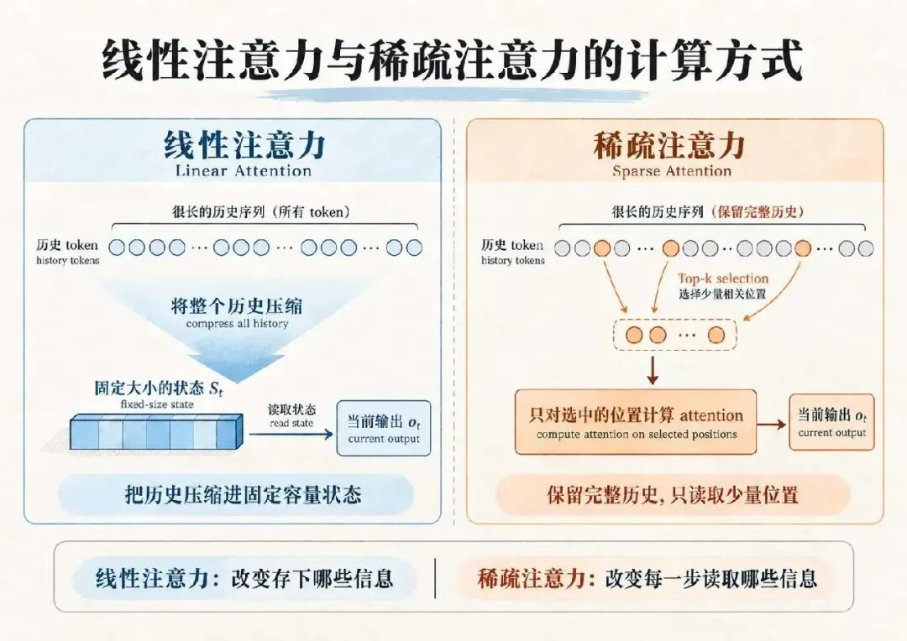
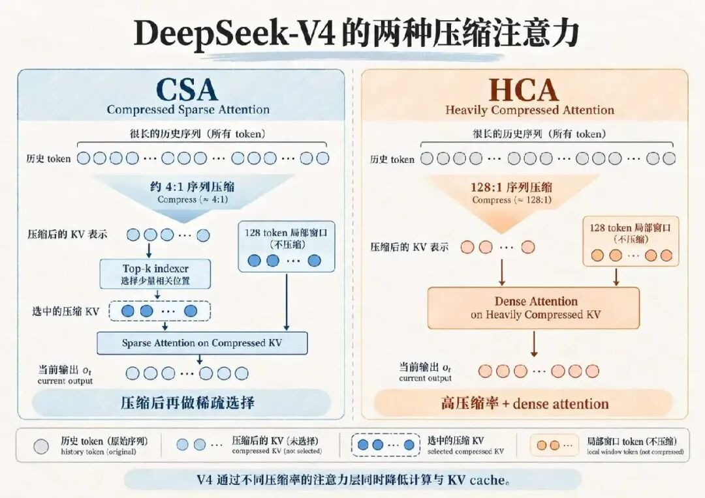
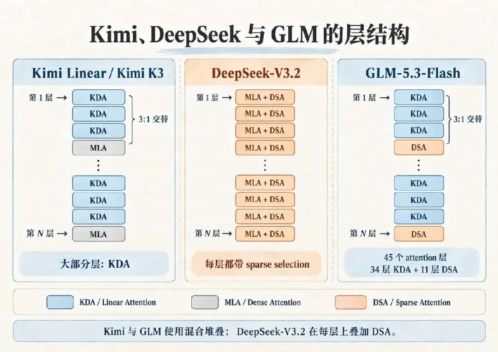
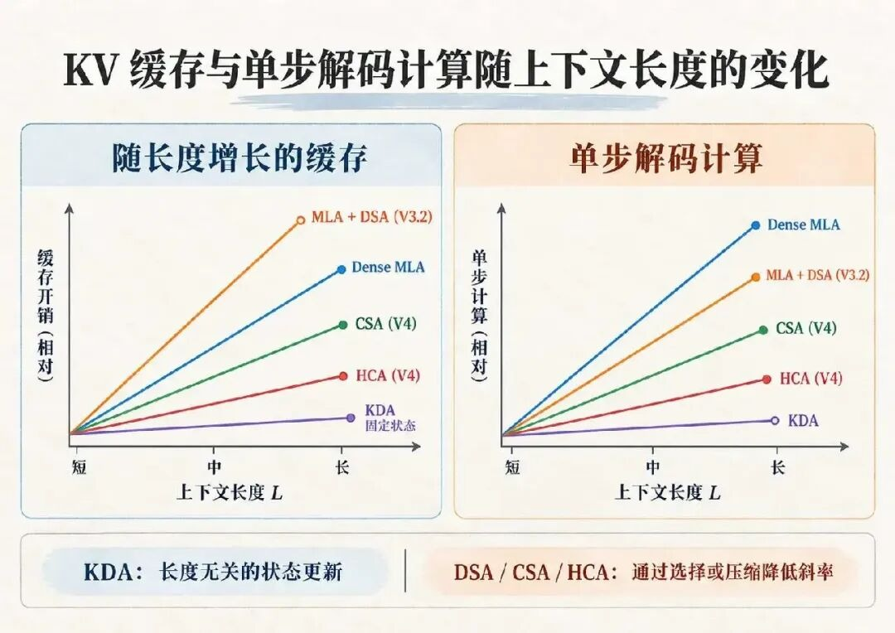
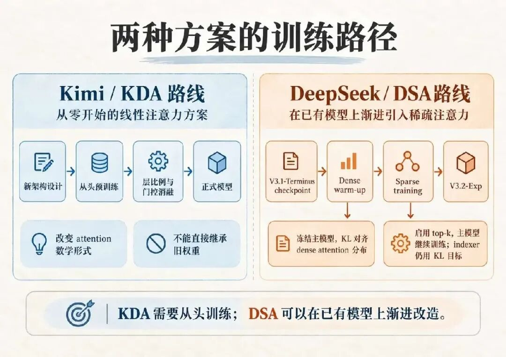
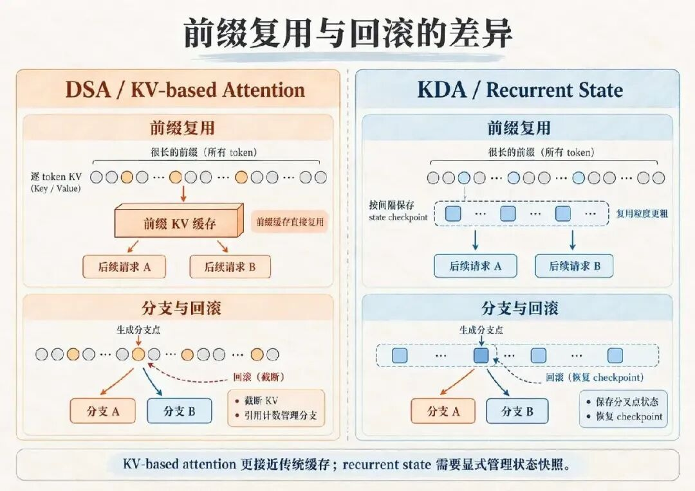
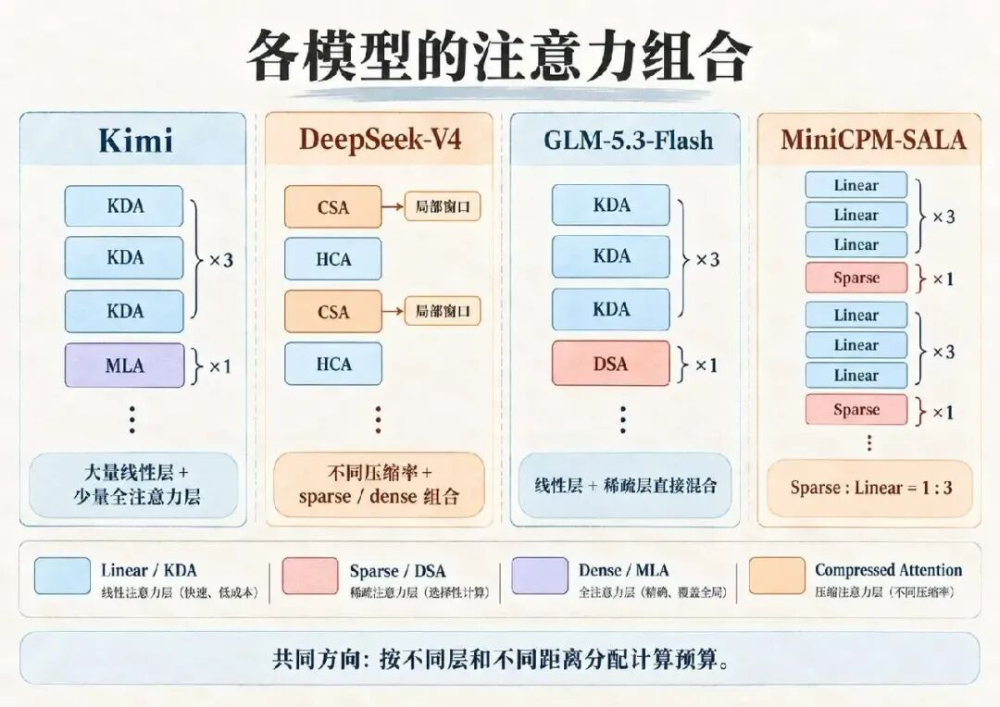

# Kimi 选线性注意力，DeepSeek 选稀疏注意力，区别在哪里？

- 公众号：医影未来
- 发布日期：2026-10-22
- 原文链接：https://mp.weixin.qq.com/s/TF84VoWJOl0c-I5xNOk5dQ

---

到了 2026 年的今天，百万 token 上下文已经成为头部模型的重要配置。agent 负载对长上下文的需求尤其直接：编码会话持续数小时，工具调用和环境反馈不断累积。在这个问题上，Kimi 和 DeepSeek 走了不同的路。**Kimi Linear 以 Kimi Delta Attention（KDA）为主要注意力层，与 MLA 全注意力按 3:1 交替；DeepSeek 在 V3.2 引入 DeepSeek Sparse Attention（DSA），到 V4 又沿序列维度压缩 KV**。本文从计算方式、复杂度、信息损失、训练和推理工程几个方面对两者进行比较。一、长上下文的成本来源softmax attention 在第  个位置的输出为上下文进入百万量级后，瓶颈随阶段变化：预填充的 attention 计算量是 ；解码阶段每生成一个 token 都要读一遍全部历史 KV，越来越受 KV cache 容量和显存带宽限制。降低开销有两类思路。线性注意力改写 attention 的数学形式，把历史压进固定大小的状态；稀疏注意力保留 softmax，只让每个 query 访问一部分历史位置。前者改变模型存下哪些信息，后者改变每一步读取哪些信息。

二、Kimi Delta Attention 的状态更新去掉 softmax 归一化后，历史 key-value 可以累加进状态矩阵 ，即 ，输出为 。**这种无条件累加会让新旧 association 互相干扰，序列越长越明显**。DeltaNet 改用 delta rule：先用当前状态预测  对应的 value，再把预测误差写回状态。Gated DeltaNet 加入每个头一个标量的遗忘门，KDA 把它扩展为通道级门控，不同状态维度按不同速度衰减。Kimi Linear 论文中的递推式为其中  为逐通道衰减系数， 控制写入强度，实验中 。**固定容量的状态无法可靠保存任意历史细节，所以 Kimi 保留了 MLA 层**。论文在 1.4T token 设置下对比了几种 KDA:MLA 比例，验证集困惑度为：0:1（纯 MLA）5.77，1:1 为 5.66，3:1 为 5.65，7:1 为 5.70，15:1 为 5.82。正式模型采用 3:1，Kimi K3 也延续了这一设计。**Kimi Linear 的 MLA 层采用 NoPE，不显式加入 RoPE 等位置编码；序列的位置信息主要由 KDA 层的递归更新与衰减机制来提供。**。三、DSA 与 V4 的 KV 压缩V3.2 的 DSA 保留 softmax，只缩小主 attention 的计算范围：**lightning indexer 用少量低维、FP8 的头为所有历史 token 计算分数 ，选出 top-k（），主 MLA 只在这些位置上计算**。DSA 减少的是高维主 attention 的计算，历史状态并没有变少：逐 token 的 MLA latent KV 仍全部保留，还要为 indexer 额外存一份 key。DeepSeek-V4 开始沿序列维度压缩 KV，交替使用两种注意力层。**CSA**（Compressed Sparse Attention）以约 4:1 的序列压缩率生成 KV 条目，再由 indexer 在压缩条目上做 top-k 选择；**HCA**（Heavily Compressed Attention）以 128:1 的压缩率生成 KV 条目，对压缩后的历史做 dense attention。压缩由专门的 compressor 完成，并非简单 pooling。两者共享一个 128 token 的滑动窗口分支，处理短距离依赖。公开数据显示，1M 上下文下 V4-Pro 的单 token 推理 FLOPs 约为 V3.2 的 27%，KV cache 约为 10%。这是整模型结果，V4 同时改了训练数据、优化器和数值精度，不能全部归到注意力层上。

四、各层类型的复杂度与缓存**MLA 是 KV 低秩压缩方式，KDA 是线性注意力，DSA 是叠加在 MLA 上的选择机制**，三者不在同一概念层级，下表按层类型比较。表中只估算长程 attention 的主要项，不计局部窗口、KV compressor、投影和 MoE 等固定或低阶开销； 为 MLA latent 维度， 为 indexer 维度。层类型预填充单步解码随长度增长的缓存Dense MLAKDA，分块并行无，状态固定为 MLA + DSA（V3.2）indexer ，主注意力 indexer ，主注意力 CSA（V4），近似indexer ，主注意力 indexer ，主注意力 约 HCA（V4），近似约 **DSA 并没有消除平方项，indexer 仍要对全部历史打分，收益来自把平方项压到低维 indexer 上。相对于同一个 MLA backbone，V3.2 的 cache 是增加的**。在 3:1 的 KDA/MLA 配置下，只有约四分之一的层承担随长度增长的 attention 计算和 KV cache。总成本不会简单降到四分之一，因为 KDA 层本身有状态更新开销，只是与长度无关。论文报告，1M 上下文下 Kimi Linear 的 TPOT 为 1.84 ms，MLA 基线为 11.48 ms，KV cache 最多减少 75%。

五、信息损失机制的差异**线性注意力把历史压入固定容量的状态，误差主要来自状态压缩和持续的覆盖写入。稀疏注意力保留逐 token 的 KV，误差主要来自选择的召回率（selection recall）。**对 Needle-in-a-Haystack 这类需要精确访问远距离单个 token 的任务，固定容量状态有明显的信息容量约束，Kimi 因此保留 MLA 层承担精确的长程访问。DSA 选中目标位置后，主 attention 仍能直接访问该 token 的 KV，不存在固定状态压缩带来的信息损失；如果漏选，该位置在当前 query 下完全不可见。短距离建模方面，KDA 的衰减门控使较新的信息经历更少的衰减；DSA 的 top-k 不保证覆盖局部邻域，V4 因此保留了滑动窗口分支。delta rule 允许对已有 association 做定向修正，更适合表达持续更新的状态**，但这能否转化为 agent 任务上的收益，目前缺少直接的对照实验**。六、训练路径KDA 改变了 attention 的数学形式，已有权重无法继承，只能从头预训练。Kimi Linear 公开模型总参数 48B、激活 3B，发布版本训练了 5.7T token。DSA 在训练好的 V3.1-Terminus 检查点上续训，分两个阶段。dense warm-up 阶段冻结主模型，以各头注意力分数求和并做 L1 归一化后的分布为目标，用 KL 散度训练 indexer。sparse training 阶段启用 top-k，继续训练主模型；indexer 仍只用 KL 目标更新，输入从计算图中分离。V3.2-Exp 与 V3.1-Terminus 的公开评测结果基本相当。

七、推理系统中的工程问题KDA 的计算可以组织成较规整的矩阵运算，但依赖 fla 库这类专用 chunkwise kernel，难点在递归状态和并行扫描。sparse attention 的难点在 top-k 之后的动态索引和不连续显存访问。**agent 多轮对话的前缀复用率很高**。DSA 保留逐 token 的 KV，前缀缓存、speculative decoding 回退和分支解码都可以通过位置截断或引用计数管理。KDA 层的复用单位是某个位置对应的 recurrent state，系统通常要按间隔保存状态 checkpoint，或显式保存分叉点状态。

批量服务上，KDA 层每个请求的状态大小固定，同样的显卡能放下更大的 batch。V3.2 的 KV 仍随长度线性增长，这也是 V4 继续压缩 KV 的原因之一。八、公开架构所体现的侧重公开架构所体现的侧重KimiDeepSeek主要优化对象大部分层的 KV cache 与解码带宽V3.2 为主 attention 计算量，V4 起加上 KV 体积已有技术基础DeltaNet 系列研究与 fla kernel，早期做过 MoBAMLA 与 FlashMLA，从 NSA 延续到 DSA架构迁移方式新架构从头预训练在 V3.1-Terminus 上续训KV 控制方式KDA 层不保存逐 token KVMLA 低秩压缩，V4 加序列维压缩以下是基于公开信息的分析：Kimi 近几代模型强调长程 agent 和长 rollout，解码侧的显存和带宽越来越重要，KDA 对这类负载收益最直接。其团队此前做过块稀疏注意力 MoBA，选择线性注意力并非没接触过另一条路线。至于全注意力层为何仍用 MLA 而非 DSA，苏剑林的解释是还没找到更好的设计，也不想一次引入太多改动。DeepSeek 长期重点投入代码、数学和推理。保留 softmax 可以避免在主 attention 里再引入一层近似，但是否因此选择 DSA，官方没有说明。可以确定的是，DSA 让 DeepSeek 沿已有的 MLA 模型和基础设施渐进改造；V3.2-Exp 上线时，API 价格下调了 50% 以上。九、线性与稀疏注意力的组合Kimi 用 KDA 承担大部分层，同时保留 MLA；DeepSeek-V4 组合了不同压缩率的 KV、sparse attention、dense attention 和滑动窗口。两者都在按层、按距离分配计算预算。**GLM-5.3-Flash 和 MiniCPM-SALA 则把两种机制放进同一个模型**。GLM-5.3-Flash 一共有 45 个 attention 层，其中 34 层为 KDA 线性注意力、11 层为 DSA，基本按 3:1 交替排列。线性层用固定状态承载大部分历史，稀疏层保留基于 token 的远程访问。

十、结论Kimi 和 DeepSeek 的区别不只在 linear attention 和 sparse attention 本身。Kimi 把大部分 attention 层改成固定状态，需要重新训练模型，也改变了推理系统管理历史状态的方式；DeepSeek 保留逐 token 的 attention 表示，先用 DSA 降低计算，再在 V4 中继续压缩 KV。GLM-5.3-Flash 和 MiniCPM-SALA 已经开始把两种机制放进同一个模型。后续更值得关注的是哪些层需要保留 token 级历史，哪些层只维护 recurrent state 就够，以及 sparse attention 和 KV compression 应该分配多少计算预算。

## 参考资料

- Kimi Team. *Kimi Linear: An Expressive, Efficient Attention Architecture*. arXiv:2510.26692, 2025.
- DeepSeek-AI. *DeepSeek-V3.2-Exp: Boosting Long-Context Efficiency with DeepSeek Sparse Attention*, 2025.
- Yang S., Kautz J., Hatamizadeh A. *Gated Delta Networks: Improving Mamba2 with Delta Rule*. ICLR 2025.
- MiniCPM Team. *MiniCPM-SALA: Hybridizing Sparse and Linear Attention for Efficient Long-Context Modeling*. arXiv:2602.11761, 2026.
- Sebastian Raschka. *CSA and HCA* (LLM Architecture Gallery).
- MarkTechPost. *DeepSeek AI Releases DeepSeek-V4: Compressed Sparse Attention and Heavily Compressed Attention*.
- SemiAnalysis. *Kimi K3: The Manos, The Mythos, The Legendos*.
- *How Sparse Attention is Unlocking Efficient Long Context*.
- *Why 2026's Best AI Models Keep 97% of Their Brains Asleep*.
